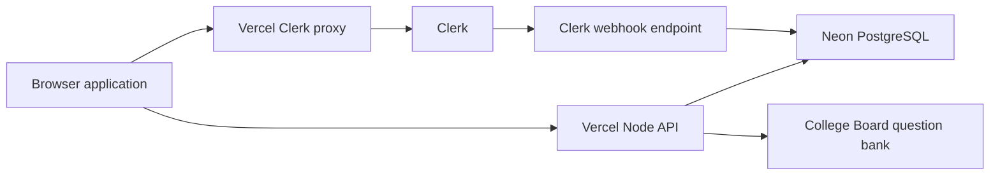

# SAT Practice architecture

## Architectural position

The application is a serverless modular monolith. Vercel serves a static browser application and routes `/api/*` to one Node.js function. A separate minimal `/__clerk/*` function proxies Clerk Frontend API traffic for provider-domain deployments without loading the database or product modules. Clerk owns identity, Neon PostgreSQL owns durable application data, and College Board is an upstream catalog provider.

This deployment shape is intentional. The product has one team, one transactional data store, and tightly related practice and vocabulary workflows. Separate microservices would add network failure modes, distributed tracing requirements, duplicate authorization logic, and higher operating cost without creating a useful scaling boundary.

## System context



## Module boundaries

The API is organized as one deployable service with explicit product boundaries. Each product module owns its routes, application services, validation contracts, and domain rules.

```text
server/
  index.js                process bootstrap only
  app.js                  injectable composition root and request pipeline
  platform/
    auth/                 Clerk adapter and authorization policies
    database/             Neon client, transactions, migrations
    http/                 routing, validation, errors, response contracts
    observability/        request IDs, logs, metrics, traces
  modules/
    catalog/              College Board import, content cache, pools
    practice/             sessions, modules, answers, timing, grading
    vocabulary/           sets, scheduling, reviews, custom words
    users/                user lifecycle and deletion
  shared/                 small dependency-free value objects and contracts
```

Dependencies point inward:

1. HTTP routes may call application services.
2. Application services may call domain functions and repository interfaces.
3. Repositories and external clients implement those interfaces.
4. Domain code never imports HTTP, Clerk, Vercel, or Neon.
5. Product modules do not query another module's private tables directly; cross-module work is coordinated by an application service and transaction.

The browser remains a deliberately small, framework-free ES module application. `auth.js` owns the Clerk gate and route selection, `app.js` owns SAT practice, and `vocab.js` owns vocabulary study. Shared security-sensitive browser behavior lives in `public/shared/browser.js`: same-origin JSON requests, session-expiry handling, response-envelope validation, and HTML text escaping. This keeps the current client lightweight while preventing each feature from inventing its own trust boundary.

## Request lifecycle

1. Vercel assigns the request to the Node function.
2. The request pipeline assigns a correlation ID and records structured events.
3. Public routes are matched explicitly. Protected routes verify the Clerk session and authorized party.
4. The verified Clerk user ID becomes the request tenant context.
5. Database operations set `app.user_id` transaction-locally; PostgreSQL row-level security enforces tenant isolation.
6. Route input is validated at the boundary before an application service runs.
7. Expected domain failures become stable 4xx error codes. Unexpected failures are logged with the request ID and return a generic 5xx response.

Clerk frontend traffic follows a smaller independent path: Vercel rewrites `/__clerk/*` to `api/clerk.js`, the adapter verifies the configured production origin and live credentials, then Clerk's maintained proxy helper forwards the stream to Clerk's fixed Frontend API host. The helper removes hop-by-hop headers, replaces the secret header, preserves the trusted Vercel client IP, and rewrites Clerk redirects back through the same-origin proxy. Proxy responses are excluded from Vercel's shared CDN cache.

## Data architecture

PostgreSQL remains the system of record. Shared reference data and tenant data are intentionally separated:

- Shared: question catalog, source identifiers, pool memberships, cached question content, built-in vocabulary.
- Tenant-owned: progress, test sessions, responses, timing, custom vocabulary membership, and review history.

Composite foreign keys prevent a child row from being attached to another user's parent. RLS is defense in depth beneath API authorization. Migrations remain append-only, checksummed, transactionally applied, and executed with a separate owner credential.

Raw SQL remains appropriate for the current query-heavy workload. An ORM is not an architectural requirement. The custom question-mark placeholder converter should eventually be replaced with native PostgreSQL parameters or a mature typed SQL layer after the server moves to TypeScript.

## Reliability and security standards

- Every external request has a deadline, bounded response size, and retries only for transient failures.
- Every API response carries a request ID; logs are structured and omit credentials and tokens.
- State-changing operations that clients may retry use idempotency keys or database constraints.
- Bulk catalog work must use a durable queue or workflow, never an in-memory serverless task.
- Authentication and webhook verification should use Clerk's maintained backend helpers.
- Untrusted or upstream HTML must be sanitized with a maintained allowlist sanitizer before rendering.
- Vercel WAF protects coarse request volume; application-level limits protect expensive per-user operations.
- Production changes pass unit, contract, RLS integration, and browser workflow tests before deployment.

## Deployment and release model

- Pull requests run deterministic unit and schema tests.
- Database integration tests run against an isolated Neon branch.
- Migrations run as an explicit release step with the admin credential; the application receives only the restricted runtime credential.
- Preview and production use separate Clerk instances or keys and separate Neon branches/projects.
- Releases are backward compatible across one deployment window so code and schema can roll independently.
- Rollback means reverting application code; destructive schema cleanup occurs only in a later migration after the compatibility window.

## Migration sequence

1. Platform foundations: request IDs, structured logs, bounded upstream HTTP, CI, and CSP hardening.
2. Security boundary: official Clerk backend verification, official webhook verification, origin enforcement, and HTML sanitization.
3. API contracts: Zod validation and stable machine-readable error codes.
4. Module extraction: catalog, practice, vocabulary, and users.
5. Operational controls: Vercel WAF limits, alerts, spend controls, and restore drills before public launch.
6. Browser workflow testing on preview deployments; adopt a larger frontend framework only if product complexity justifies it.

## Deliberately rejected choices

- **Microservices now:** no independent scaling or ownership boundary justifies the operational burden.
- **ORM solely for appearance:** it would not remove the need for SQL, RLS, constraints, or query-plan review.
- **A complete framework rewrite:** rewriting working behavior before contract tests exist increases risk and delays security work.
- **In-memory rate limits or jobs on Vercel:** instances are ephemeral and do not provide durable global coordination.

The local-only bulk cache job is disabled on Vercel. Hosted question content is cached transactionally on demand. Global request limiting belongs at Vercel's edge, where it is consistent across function instances.
